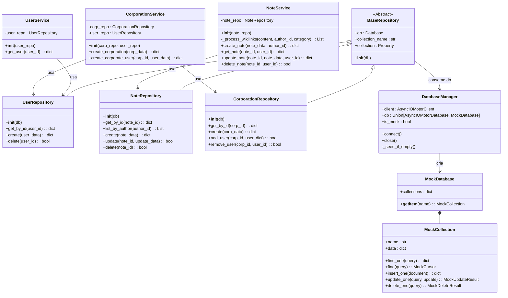
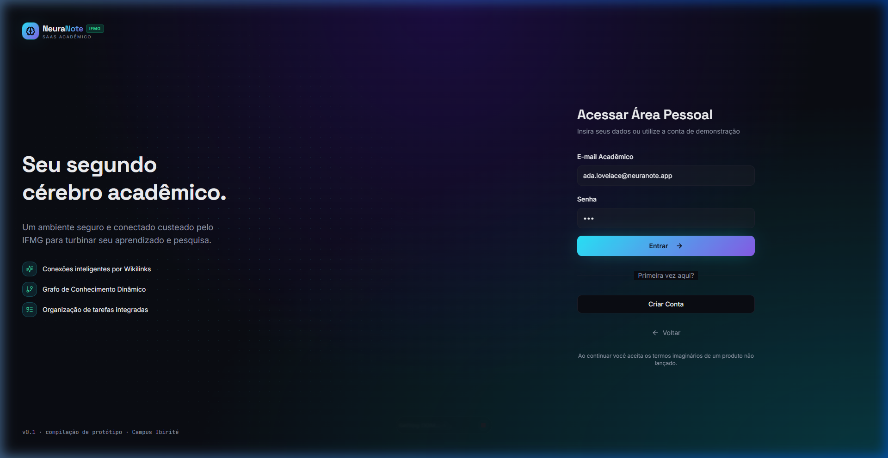
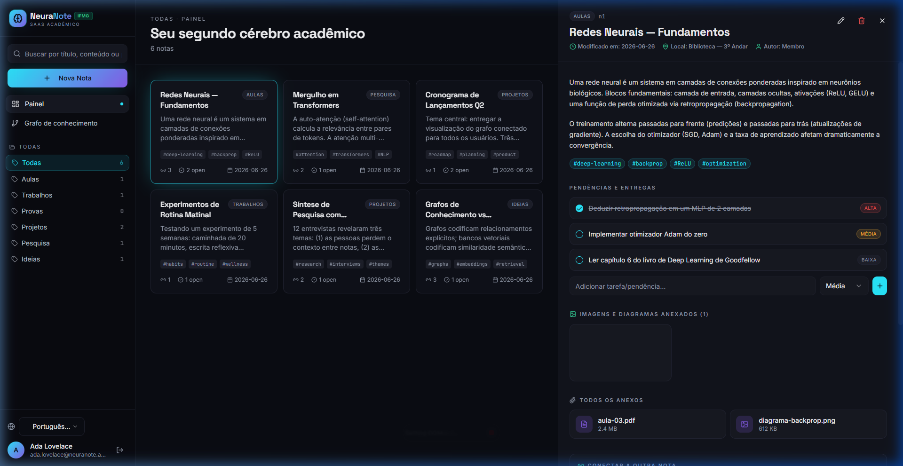
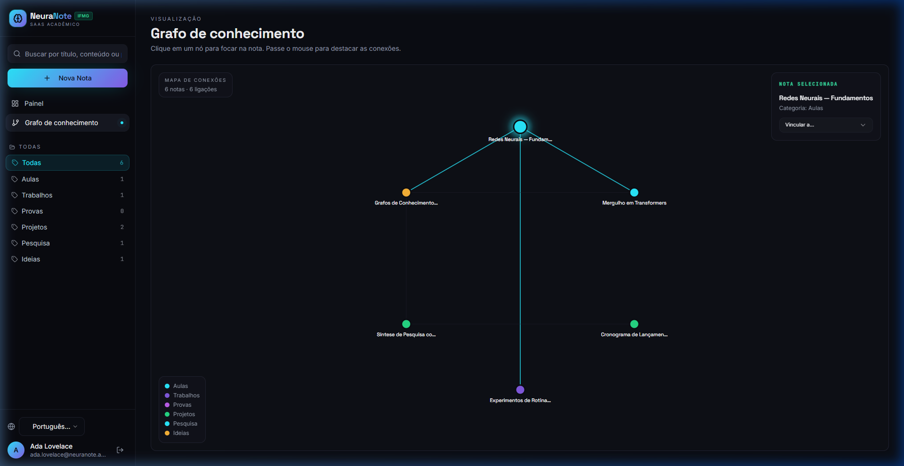

# NeuraNote 🧠 — Relatório Técnico do Sistema

Este relatório apresenta os fundamentos do **NeuraNote**, um aplicativo de anotações baseado no conceito de "segundo cérebro" (Second Brain), com foco em *Mobile-First*, relações semânticas e tarefas contextualizadas. Toda a análise abaixo é fundamentada diretamente no código atual do projeto.

---

## 1. Introdução

O **NeuraNote** é uma solução inovadora de gerenciamento de conhecimento pessoal e corporativo, inspirada no método do "segundo cérebro" (como definido por Tiago Forte). Ele foi desenvolvido para funcionar sob o paradigma Mobile-First, com foco em uma experiência de uso responsiva, adaptável e com transições fluidas. A sua grande força está nas conexões semânticas entre as notas, organizadas de forma visual em um grafo interativo de conexões 2D de forma dinâmica.

Desenvolvido com uma arquitetura de duas camadas (Client-Server), o NeuraNote possui:
- Um **Backend em Python** estruturado em Programação Orientada a Objetos (POO) com o framework **FastAPI**, utilizando bancos de dados NoSQL (MongoDB) e um mecanismo resiliente de banco de dados em memória para demonstrações locais.
- Um **Frontend em React + TypeScript** que emprega o *Store Pattern* para gerenciamento de estado global e renderiza um mapa de conexões visuais interativas utilizando SVG e layouts matemáticos.

A aplicação opera em dois modelos de inquilinato (SaaS):
1. **Espaço Pessoal (Personal Workspace)**: Focado em privacidade e simplicidade para o usuário comum.
2. **Espaço Corporativo (Corporate Workspace)**: Projetado para equipes de alto desempenho, contando com herança de permissões baseada em papéis (RBAC).

---

## 2. Problema Identificado

Nos sistemas tradicionais de anotações e produtividade, os usuários enfrentam três grandes desafios:
1. **Silos de Conhecimento**: Notas textuais são salvas em categorias estáticas e pastas rígidas. Isso impede a associação cruzada de ideias, dificultando a descoberta de conexões não óbvias.
2. **Desconexão entre Contexto e Ação**: Listas de tarefas residem em gerenciadores dedicados (como Trello ou Todoist), longe do local onde os pensamentos e pesquisas que geraram essas tarefas foram redigidos.
3. **Complexidade no Compartilhamento e Permissões**: Falta de soluções flexíveis que suportem, de forma nativa e unificada, o uso confidencial do indivíduo e a colaboração corporativa com herança rígida de permissões e controle de papéis (Admin, Manager, Developer, Viewer).

---

## 3. Público-Alvo

O público-alvo do NeuraNote é constituído por:
* **Estudantes Universitários e Pesquisadores**: Que necessitam correlacionar disciplinas, gerenciar prazos, bibliografias e visualizar grafos de conceitos acadêmicos.
* **Desenvolvedores e Profissionais do Conhecimento**: Que demandam um local centralizado para organizar documentações técnicas, documentar arquiteturas, registrar reuniões e encadear links de referência rápida.
* **Equipes de Pesquisa, Produto e Desenvolvimento**: Empresas e startups que precisam construir uma base corporativa de conhecimento compartilhado e estruturado com controle fino de acessos.

---

## 4. Levantamento de Requisitos

O sistema foi modelado com base nas necessidades identificadas de gerenciamento ágil de conhecimento. Abaixo estão descritos os principais requisitos técnicos.

### Requisitos Funcionais (RF)

| ID | Nome do Requisito | Descrição |
|---|---|---|
| **RF01** | Autenticação Multi-Tenant | O sistema deve suportar cadastro e login em modo Pessoal (senha hash) e Corporativo (associado a uma empresa e a um papel específico). |
| **RF02** | CRUD de Anotações | O usuário deve ser capaz de criar, ler, atualizar e excluir notas contendo título, conteúdo, categoria, localização e palavras-chave. |
| **RF03** | Wikilinks e Criação de Stubs | Ao escrever `[[Título da Nota]]` no texto de uma nota, o backend deve criar automaticamente uma nota vazia rotulada como "stub" caso o título referenciado não exista no banco de dados. |
| **RF04** | Conexões Bidirecionais | Ao criar uma conexão da Nota A para a Nota B, o backend deve injetar automaticamente uma conexão reversa de B para A, mantendo integridade nos links. |
| **RF05** | Tarefas Contextualizadas | Cada nota deve suportar uma lista de To-Do integrada no conteúdo, com níveis de prioridade (*High, Medium, Low*) e controle de conclusão. |
| **RF06** | Upload de Anexos | O usuário deve poder anexar arquivos (PDFs, Imagens, Áudios, Documentos) a cada nota, com verificação de tipo de arquivo. |
| **RF07** | Grafo de Conhecimento | O frontend deve renderizar um mapa 2D interativo conectando visualmente as notas do usuário por meio de suas relações semânticas. |
| **RF08** | Painel de Administração | Administradores corporativos devem poder convidar novos usuários, gerenciar o quadro de membros da organização e alterar seus papéis. |
| **RF09** | Histórico e Auditoria | O sistema deve gravar entradas cronológicas contendo ações efetuadas na nota (criação, edição, anexo) identificando o autor e o timestamp. |
| **RF10** | Internacionalização | A interface web deve permitir a troca de idiomas em tempo real (Português, Inglês, etc.). |

### Requisitos Não Funcionais (RNF)

* **RNF01 (Usabilidade/Mobile-First)**: A interface do usuário deve ser otimizada para telas móveis, empregando layout responsivo que se adapta para visualizações expandidas em computadores.
* **RNF02 (Resiliência do Banco de Dados)**: Caso a conexão com a instância física do MongoDB falhe ou esteja indisponível localmente, o backend deve automaticamente migrar para uma simulação em memória (`MockDatabase`) transparente e pré-semeada.
* **RNF03 (Segurança)**: As senhas dos usuários devem ser criptografadas no banco usando `bcrypt`. A persistência da sessão deve ocorrer via tokens JWT assinados com chave secreta no backend.
* **RNF04 (Portabilidade e Desempenho)**: O frontend deve carregar de forma otimizada via Vite e modularizar o estado por meio do Store Pattern, reduzindo renderizações excessivas no grafo SVG.

---

## 5. Diagrama de Classes

O diagrama a seguir descreve a estrutura orientada a objetos das principais classes de negócio do backend do NeuraNote, demonstrando como os repositórios, serviços e modelos interagem.



---

## 6. Explicação da Arquitetura

O sistema é desenhado de acordo com a arquitetura multicamadas:

```
+-------------------------------------------------------------+
|                     React Frontend SPA                      |
| (Componentes React + Store Pattern useStore + Tailwind CSS) |
+------------------------------+------------------------------+
                               |
                        Chamadas HTTP REST
                               |
+------------------------------v------------------------------+
|                     FastAPI Router (APIs)                   |
|  (Gerencia endpoints HTTP, rotas REST e valida Pydantic)   |
+------------------------------+------------------------------+
                               |
                      Injeção de Dependências
                               |
+------------------------------v------------------------------+
|                        Service Layer                        |
|  (Centraliza regras de negócios: Wikilinks, Histórico, RBAC)|
+------------------------------+------------------------------+
                               |
                      Repository Pattern
                               |
+------------------------------v------------------------------+
|                      Repository Layer                       |
|   (Abstração das consultas NoSQL por entidade de domínio)   |
+------------------------------+------------------------------+
                               |
                       Database Access
                               |
+------------------------------v------------------------------+
|        MongoDB Database  <--- Fallback ---> MockDatabase    |
|       (Async Motor Client)                (In-Memory Dict)  |
+-------------------------------------------------------------+
```

### Detalhes dos Componentes Arquiteturais

1. **Camada de Rotas (Controller)**: Definida no diretório `backend/routes/`. Seus arquivos (ex: `notes.py`, `auth.py`) recebem as chamadas REST HTTP, validam os dados utilizando modelos do Pydantic (Camada de Validação) e despacham a execução para a camada de serviços correspondente.
2. **Camada de Serviço (Service Layer)**: Encapsula a lógica principal da aplicação. O arquivo `note_service.py` é um exemplo claro: ao atualizar ou criar uma nota, ele executa um parser regex para identificar se existem Wikilinks em seu conteúdo, cria novos stubs no banco, atualiza conexões reversas de forma transacional e insere logs de auditoria no histórico da nota.
3. **Repository Pattern (Camada de Persistência)**: Implementado sob a classe base `base_repository.py`, ele assegura que nenhuma consulta específica ao banco (como `find_one` or `update_one` do MongoDB) ocorra fora de um repositório dedicado. Isso mantém a lógica de negócio do sistema independente do mecanismo de armazenamento.
4. **Dependency Injection (DI)**: No arquivo `dependencies.py`, o contêiner do FastAPI é usado para resolver e injetar os repositórios nas instâncias de serviços e, por sua vez, injetar os serviços nas rotas. Isso promove o baixo acoplamento.
5. **Store Pattern (Frontend)**: O estado da interface web é centralizado de forma global e persistente em `useStore.tsx` através de React Context, garantindo consistência de dados entre a barra lateral de navegação, a lista de notas, a visualização gráfica e o painel de afazeres.

---

## 7. Explicação do Uso dos Conceitos de POO

O backend do NeuraNote serve como um estudo de caso ideal da aplicação de conceitos clássicos de Programação Orientada a Objetos (POO):

### A. Abstração
A abstração é implementada para ocultar a complexidade do acesso a dados. O arquivo `base_repository.py` define uma classe que abstrai o acesso a qualquer banco de dados. Os serviços interagem com interfaces simplificadas (como `self.note_repo.create()`), sem necessitar conhecer comandos complexos do driver de banco de dados subjacente.

```python
class BaseRepository:
    def __init__(self, db):
        self.db = db
        self.collection_name = None

    @property
    def collection(self):
        if not self.collection_name:
            raise NotImplementedError("collection_name deve ser definida nas subclasses")
        return self.db[self.collection_name]
```

### B. Herança
A reutilização de código é feita por herança estrutural e comportamental:
* **Herança de Repositórios**: O `NoteRepository` estende `BaseRepository`, herdando seus atributos e seu inicializador. Ele define seu próprio atributo `self.collection_name = "notes"`, que é consumido dinamicamente pela propriedade `collection` herdada.
* **Herança de Modelos**: Em Pydantic, a herança é usada para definir ciclos de vida de dados sem redundância de campos. `UserCreate` e `UserResponse` herdam os atributos básicos de `UserBase` (como email e nome), adicionando apenas os atributos necessários para seus contextos específicos (como senha em um e token/role no outro).

### C. Polimorfismo e Duck Typing
O exemplo mais expressivo do sistema está na resiliência de banco de dados implementada em `database.py`. 

O repositório espera receber um objeto de banco de dados contendo coleções utilizáveis. Em desenvolvimento ou caso o MongoDB local esteja offline, o sistema instancia um `MockDatabase` no lugar de `AsyncIOMotorDatabase`. Graças ao polimorfismo (via *duck typing* nativo do Python), ambas as classes compartilham a mesma assinatura de métodos públicos:
* `MockDatabase["notes"]` retorna uma `MockCollection`, que implementa os mesmos métodos de persistência assíncronos (`find_one`, `insert_one`, `update_one`, `delete_one`) expostos pelo driver oficial do MongoDB.
* O restante do sistema (camadas de repositórios e serviços) continua funcionando sem qualquer modificação e sem saber qual banco está de fato ativo.

### D. Encapsulamento
Atributos internos e regras críticas são encapsulados dentro de métodos especializados, prevenindo estados inconsistentes. 
* As operações de Wikilinks são processadas internamente pelo método privado `_process_wikilinks` na classe `NoteService`.
* Para gerenciar o histórico de auditoria das notas, o método `add_to_history` manipula internamente as entradas da lista cronológica, garantindo que o cabeçalho de histórico seja inserido corretamente antes de gravar a informação no repositório.

---

## 8. Prints do Sistema

Abaixo estão exibidas as telas principais da aplicação NeuraNote, capturadas diretamente do servidor de desenvolvimento local.

### A. Tela de Entrada e Autenticação
Esta tela é o ponto de entrada da aplicação. Ela permite a seleção entre o espaço corporativo e o pessoal.


*Figura 1: Tela de Login Pessoal com preenchimento das credenciais de demonstração (Ada Lovelace).*

### B. Painel de Controle Principal (Dashboard)
A interface de usuário adota o estilo moderno *glassmorphism* com tema escuro e painéis contextuais.


*Figura 2: Dashboard mostrando a nota de Redes Neurais ativa, sua lista de afazeres com prioridades, a barra lateral de categorias e o histórico de revisões.*

### C. Grafo de Relações de Conhecimento
Renderizado a partir de elementos SVG estruturados no frontend, mapeando de forma espacial as conexões do segundo cérebro.


*Figura 3: Grafo de Conexões interativo com nós organizados radialmente e coloridos de acordo com a categoria da anotação, exibindo as conexões bidirecionais das ideias.*

---

## 9. Conclusão

O desenvolvimento do **NeuraNote** demonstra o poder de uma modelagem de software bem pensada. A aplicação combina uma interface de usuário responsiva e atraente (*Mobile-First*) com um backend flexível e desacoplado.

O uso correto de conceitos de Programação Orientada a Objetos (POO) no backend — em especial a abstração com o Repository Pattern e o polimorfismo para suporte ao `MockDatabase` em memória — permitiu que o sistema se tornasse altamente resiliente e fácil de testar, além de garantir que a lógica de negócios permaneça intacta diante de qualquer substituição de tecnologia de persistência. A linkagem bidirecional em tempo real é executada de forma eficiente pelo backend e mapeada dinamicamente no frontend pelo grafo de conexões. 

Como melhorias futuras, sugerimos a expansão do grafo para visualizações tridimensionais, integração de análises automáticas com inteligência artificial local (via Ollama) para resumir links de notas, e exportação nativa em arquivos Markdown portáveis compatíveis com arquivos de outros softwares como Obsidian.

---

## 10. Referências

1. **FORTE, Tiago**. *Criando um Segundo Cérebro: O método comprovado para organizar sua vida digital e destravar sua força criativa*. Editora Sextante, 2023.
2. **MARTIN, Robert C**. *Arquitetura Limpa: O guia do artesão para estrutura e design de software*. Editora Alta Books, 2019.
3. **FASTAPI Framework Documentation**. *FastAPI - Concurrency and sub-dependencies*. Disponível em: <https://fastapi.tiangolo.com/>. Acesso em: 25 jun. 2026.
4. **REACT Dev Documentation**. *React Context API and custom hooks state management*. Disponível em: <https://react.dev/>. Acesso em: 25 jun. 2026.
5. **MONGODB Manual**. *NoSQL databases, document models, and asynchronous interfaces*. Disponível em: <https://www.mongodb.com/docs/>. Acesso em: 25 jun. 2026.
